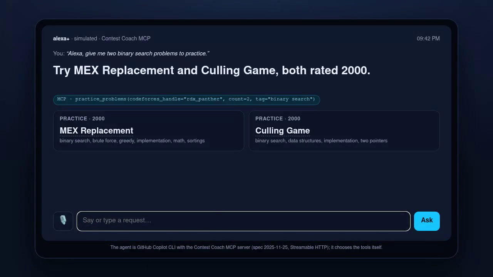

# Contest Coach: an MCP server for Alexa+

A voice-first coach for competitive programmers. It's a self-hosted **MCP server** (spec **2025-11-25**, **Streamable HTTP**) that an assistant like Alexa+ can call to answer:

- "When's the next contest?" → `upcoming_contests` (Codeforces + LeetCode)
- "How did my last contest go?" → `my_ratings`
- "What am I weak at?" → `weak_topics`
- "Give me something to practice." → `practice_problems`
- "What should I practice today?" → `daily_plan`

Every tool returns a short sentence to read aloud (`speech`) and structured data (`structuredContent` with an `outputSchema`), so a voice assistant can speak the answer and a screen device can show the links. All tools are read-only (`readOnlyHint`) and use only public data, so no logins are needed.

## How "weak topics" works

From your Codeforces submissions and the full problemset, for each tag it looks at:
- how often the tag appears in problems near your rating (`rating − 200` to `rating + 300`),
- how many problems with that tag you've solved (more practice → lower priority),
- how often you fail it (wrong answers and TLEs raise the priority).

`practice_problems` then picks unsolved problems 100–300 above your rating in those tags, preferring recent, well-tested contests.

## Demo: a simulated Alexa+ screen



`demo/` contains a small Echo Show-style page. A request (typed, or spoken with the browser's speech recognition) goes to an AI agent, here GitHub Copilot CLI with this server configured as an MCP server, which picks the tools itself. The answer is read aloud, and the screen shows exactly which tools were called and their structured results. These come from the server's opt-in call log (`COACH_RECORD_CALLS=1`, `GET /recent-calls`).

```bash
COACH_RECORD_CALLS=1 npm start      # MCP server on :3333
npx tsx demo/server.ts              # simulator on http://127.0.0.1:3334 (needs `copilot` with this server in ~/.copilot/mcp-config.json)
```

Copilot CLI config entry:

```json
{ "mcpServers": { "contest-coach": { "type": "http", "url": "http://127.0.0.1:3333/mcp", "tools": ["*"] } } }
```

## Run

```bash
npm install
npm start                      # http://127.0.0.1:3333/mcp
npx tsx test/client.ts         # calls every tool with the official MCP client
```

`COACH_TIMEZONE` (default `Asia/Kolkata`) controls how start times are spoken.
